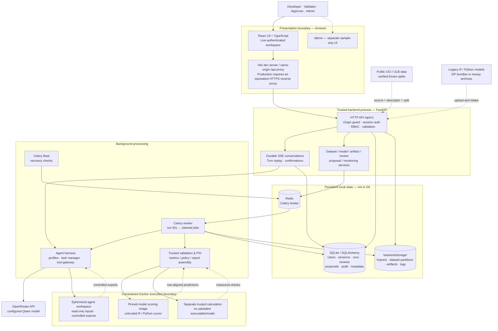
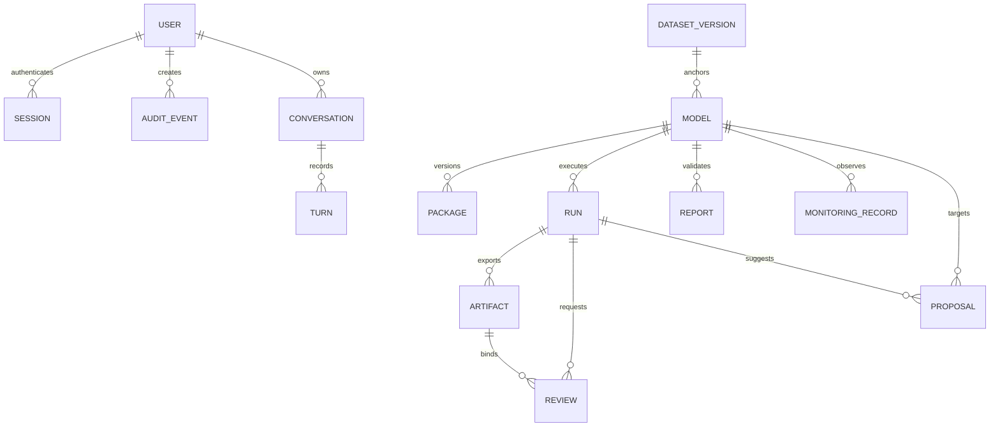
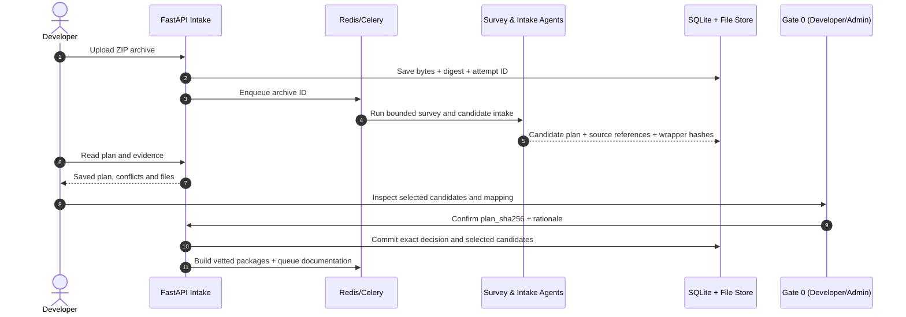

# Roundhouse — System Architecture

> **Engineering design reference · 13 November 2026**  
> This document explains the logical and deployment architecture, data flows, controls and limitations of the Roundhouse prototype in this repository. It is not evidence of a production deployment.

Roundhouse is an **agentic model-risk workbench** for legacy machine-learning model ingestion, documentation, R-to-Python modernization, independent validation, human governance, and drift monitoring. It separates **probabilistic agent analysis** from **deterministic measurement and authorization**.

**Design principle:** *Agents investigate and propose; trusted code measures; authorized humans decide.*

For installation, operating procedures, and a guided demonstration, see [README.md](README.md).

## 1. Architecture at a glance

The following Mermaid diagram is the **reference architecture diagram** for the platform. It models trust and execution boundaries, not merely the repository folder structure. Solid arrows show normal application traffic; dotted arrows indicate external or artifact exchange.



### Reading the diagram

1. **The browser is untrusted presentation code.** It can display saved state and submit authenticated requests; it cannot grant its own permissions or make official model-risk decisions.
2. **FastAPI is the authoritative control plane.** It checks sessions, origin, roles, identifiers, versions, upload contracts, and action preconditions. It commits state to SQLite and files to managed storage.
3. **Redis is a broker, not the application database.** Celery dispatches persistent run/upload/intake/scoring work by ID, and the worker loads authoritative records from SQLite before executing anything.
4. **The agent harness is an orchestrated subsystem.** It handles model documentation, rebuilds, survey/intake, validation narratives, triage, investigation, and chat. The provider key stays outside agent containers.
5. **Model execution is isolated.** User-supplied scoring code and fitted artifacts run in restricted Docker environments, not inside the FastAPI process. A separate trusted calculation path computes official validation metrics from scored results.
6. **Human gates and action proposals form the governance layer.** Agent output alone cannot approve a model, approve a proposal, or rewrite a measured failure.

## 2. Component responsibilities

| Layer | Main implementation | Responsibility | It must not do |
| --- | --- | --- | --- |
| Presentation | `frontend/src/`, `frontend/e2e/` | Views, navigation, forms, progress, evidence, session-aware requests, SSE display | Trust a browser role flag as authorization or invent missing evidence |
| API control plane | `backend/app/main.py`, `backend/app/api/` | Request validation, sessions, upload and review contracts, HTTP errors, IDs | Execute arbitrary uploaded files in the API process |
| Domain services | `backend/app/services/` | Dataset integrity, snapshots, model lifecycle, parity, reports, proposals, monitoring, storage | Permit silent mutation of immutable evidence |
| Persistence | `backend/app/db/`, SQLite | Durable metadata, users, sessions, runs, reviews, reports, audit records, proposals | Substitute for versioned production DB migrations |
| Local object storage | `backend/storage/` | Uploaded source, split partitions, packages, agent artifacts, logs | Be committed to a public code repository |
| Queue | `backend/app/workers/`, Redis | Dispatch, claiming, recovery, asynchronous execution | Hold untrusted source bytes or secrets in task arguments |
| Agent orchestration | `backend/harness/`, `backend/contracts/harness.py` | LLM prompts/profiles, bounded tools, task state, Docker workspace, export checks | Create official metrics or approve itself |
| Scoring + validation | `legacy_models/`, `app/services/legacy_scoring.py`, `validation_metrics.py`, `report_service.py` | Sandboxed scores, trusted metrics, deterministic parity, PSI | Let the generator select its own protected-test results |

The source also includes `download_datasets.py`, `validate_all_models.py`, legacy bundle builders, and reproduction tools. These are useful **offline developer tools** rather than alternatives to authenticated end-to-end review.

## 3. Deployment and process model

### Local development

The verified development topology is a **single-machine, multi-process setup**:

- **Vite/React:** usually `http://127.0.0.1:5173`.
- **FastAPI:** `http://127.0.0.1:8000`, API under `/api/v1`, `/docs` for OpenAPI, `/health` for liveness.
- **Redis:** usually `127.0.0.1:6379/0`, configurable with `REDIS_URL`.
- **Celery worker:** usually started with `--pool=solo`; performs registered asynchronous jobs.
- **Celery Beat:** periodically schedules run recovery.
- **Docker daemon:** creates restricted agent and model-scoring containers on demand.
- **SQLite:** defaults to `backend/storage/app.db` via SQLAlchemy's asynchronous driver; no separately deployed DB service is required for the demo.
- **OpenRouter:** external HTTPS API, required for real LLM-powered agent tasks.

The worker's payload is a **run or upload identifier**. The durable record, file paths, actor identity, and current state are resolved server-side. Celery's `worker_prefetch_multiplier=1` and late acknowledgements reduce queued-work ambiguity; the database claim prevents ordinary duplicate deliveries from executing the same run twice. Recovery is not a claim of perfect distributed exactly-once execution.

**Production boundary:** there is no verified public hardened hosting configuration, cloud database schema-upgrade strategy, or multi-node locking design. The sandbox image is public at `ghcr.io/merry-go-round-org/sandbox` and can also be rebuilt from `backend/harness/sandbox_image/`. The local topology should not be described as production-ready.

### Browser and origin boundary

The frontend sends requests to a same-origin `/api` proxy, which forwards to FastAPI. The backend checks the origin of authentication and cookie-protected writes, and exposes only configured CORS origins. Cookies are **HTTP-only, SameSite=Lax, revocable and server-stored**. The `AUTH_COOKIE_SECURE` setting must be enabled when deploying over HTTPS; never disable origin checks merely to solve a 403.

`localhost` and `127.0.0.1` are not interchangeable browser origins. The separate `/demo` route renders an in-memory example and does **not** access the same live model inventory or authenticated workflow by virtue of being present in the UI.

## 4. Persistent information and data model

### Logical entity graph



This is a **conceptual data model**, not an exact list of SQLAlchemy table or foreign-key names. The application also retains upload attempts, archive plans, agent tasks and calls, findings, execution controls, idempotency receipts, and provenance.

### Storage directory and Git policy

```text
backend/
├── app/db/                    # tracked database model and initialization source
├── app/bootstrap.py           # tracked account/bootstrap logic
└── storage/                   # NOT TRACKED (README placeholder may be tracked)
    ├── app.db                 # local SQLite runtime database
    ├── imports/               # uploaded packages/archives and staging
    ├── datasets/              # verified source, split, immutable partitions
    ├── artifacts/             # generated reports and exports
    ├── logs/                  # local diagnostics
    └── local-demo-credentials.txt   # generated, private demo passwords
```

**There is no need to migrate the old `app.db` file or any real credentials into Roundhouse.** Fresh bootstrap and application startup create the tables and required runtime directories. Retain the schema and code, not old instances' contents. SQLite schema creation is additive (`create_all`), not a general versioned migration framework. Any persistent real installation needs backups and a controlled migration plan before changing schema.

Uploaded dataset versions, model package snapshots, validation artifacts, review decisions, and proposals are treated as immutable or version-bound evidence. Deletion is implemented as **soft deletion**: eligible records disappear from current lists while retained reports, runs, audit records, and files remain available under the applicable governance policy. It is not secure erasure.

## 5. Model and dataset ingestion

### Path A — verified dataset upload

The API accepts multipart **original source data**, **`dataset.json` descriptor**, and an **optional split CSV**. The backend verifies SHA-256, required columns, source row identities, complete/disjoint train-validation-test membership, partition counts, and the immutable dataset ID/version. No public data file is stored in Git as part of the runtime upload.

The two supported canonical families in the current code are:

| Family ID | Rows | Train | Validation | Test | Canonical rule |
| --- | ---: | ---: | ---: | ---: | --- |
| `uci_credit` | 30,000 | 17,981 | 6,037 | 5,982 | Frozen UCI ID-based split and pinned source bytes |
| `ulb_fraud` | 284,807 | 162,992 | 61,675 | 60,140 | Frozen ULB split deterministically restored from transaction row sequence |

If the split is **omitted**, the backend can copy the exact pinned UCI membership or restore the exact pinned ULB membership when the source and descriptor satisfy the existing family contract. It does **not** resplit the data using a new random seed. Although a future deterministic strategy and server-generated dataset families were proposed, `DatasetDescriptor` still restricts `dataset_id` to those two families in the current implementation. New generic dataset IDs and generic automatic splits are therefore **not operational**.

### Path B — structured model package

`POST /api/v1/models/uploads` accepts a ZIP containing a root-level manifest, schema, serialized model or R artifact, scorer, and approved fixtures/provenance. The ingestion service checks paths, file hashes, manifest/schema contracts, row alignment, and source compatibility. A verified inventory entry is built from the actual accepted package. Missing ownership/tier metadata is displayed as unknown rather than fabricated.

The upload-level **reproduction check** executes the submitted scorer on stored development fixtures. It is advisory and separate from:

- **Official rebuild parity**, comparing a rebuilt candidate against committed development reference predictions.
- **Independent validation**, which recomputes new metrics from frozen partitions and requires a governance review.

### Path C — unstructured archive and Gate 0



Survey and intake agents propose metadata and possible scoring wrappers. The backend checks the exports and stores a **plan hash**. A human confirms which candidates, if any, may be registered. This is **Gate 0** and it cannot be replaced by automatic confidence scoring or chat text. Unsafe archive material, unresolved files, and incompatible model/data mappings must be reported, not silently accepted.

## 6. Agent harness and execution isolation

### The harness

The agent core comprises task schemas, durable task state, profile-specific instructions, an OpenRouter streaming client, tool gateway, task manager, environment-limited sandbox, and export validators. Primary files include:

- `backend/harness/profiles.py` — allowed tools, system prompts, roles, agent-kind limits.
- `backend/harness/loop.py`, `manager.py`, `store.py`, `db.py` — task execution, concurrency, continuation, cancellation, auditing.
- `backend/harness/llm.py` — provider transport and usage tracking.
- `backend/harness/runner.py` and `backend/contracts/harness.py` — backend integration contract.
- `backend/harness/sandbox.py` — ephemeral container lifecycle and bounded file/command tools.
- `backend/harness/outputs.py`, `document_template.py`, `validation_report.py`, `metrics_bundle.py` — export structure and narrative consistency.
- `backend/app/services/harness_adapter.py`, `ai_native_service.py`, `native_runner.py`, `native_analysis.py` — trusted backend orchestration and artifact adoption.

The currently configured default model in harness code is `qwen/qwen3.8-27b` via OpenRouter; availability, provider routing, pricing, and configured budgets must be verified for each environment. **Only the trusted API/worker environment receives the provider key.** It must not be mounted into a Docker task, copied to a browser bundle, or embedded in a Redis job.

### Tool boundary and sandbox

Ephemeral agent containers are started with **no network**, **all Linux capabilities dropped**, **no-new-privileges**, **non-root user**, **read-only root filesystem**, and CPU, memory, PID, and temporary-directory limits. They receive selected, controlled data mounts and a writable isolated workspace for exports; they do not receive the operator's whole file system. User-supplied scoring code runs in similarly restricted, pinned Docker scoring containers.

The platform resolves mounts from trusted context IDs, not arbitrary agent-requested host paths. A model-document agent may see a model package and permitted development data; a validation narrative agent sees sanitized deterministic metrics. **Protected final-test rows and labels are not mounted to agents.** The trusted metric process may use test labels to calculate official evidence *outside* the agent boundary.

Model scoring and metric computation are separate phases: the **scorer** produces row-aligned predictions in a constrained model container, and a **trusted calculation service** verifies alignment and computes metrics in its own environment without executing uploaded model code.

### Agent kinds

| Kind | Purpose | Authorized output |
| --- | --- | --- |
| `document` | Analyze a model package and produce an evidence-backed model document | Structured document for Gate 1 |
| `rebuild` | Port an eligible legacy R model to a Python candidate | Candidate package for parity and Gate 2 |
| `survey` | Identify candidate models in an archive | Survey summary for the intake planner |
| `intake` | Infer candidate inventory fields and proposed scoring wrapper | Plan for human Gate 0 |
| `validation` | Interpret the official metrics bundle independently | Narrative, challenger evidence, potential findings |
| `triage` | Explain an amber stability signal | Triage report or suggested action |
| `investigation` | Investigate red/escalated drift | Report and bounded action proposals |
| `chat` | Read supported state and guide the operator | SSE response and explicit action/proposal requests |

Agents may be retried or continue after feedback, but saved versions and human gates preserve the provenance of prior work.

**Runtime Markdown assets are not redundant public documentation.** The harness directly reads `harness/guides/usage_guide.md`, `harness/templates/model_document.md`, and `harness/templates/validation_narrative.md`. Those files must remain available, or equivalent in-code/package assets must be implemented and tested. Keeping only two *public-facing documentation files* is compatible with those runtime requirements; deleting every `.md` in the codebase without changing the loaders is not.

## 7. Evidence chain and governance gates

```mermaid
flowchart LR
    UP["Uploaded model + immutable dataset"] --> DOC["Agent documentation"]
    DOC --> G1{"Gate 1\nindependent review"}
    G1 --> RB["R to Python rebuild"]
    RB --> PAR["Official parity-v1\n100 development rows"]
    PAR --> G2{"Gate 2\nindependent review"}
    G2 --> VAL["Trusted scoring + metrics"]
    VAL --> VA["Independent validation narrative"]
    VA --> G3{"Gate 3\nindependent approver"}
    G3 --> PSI["PSI monitoring"]
    PSI --> TRI["Amber triage / red investigation"]
    TRI --> PROP{"Action proposal"}
    PROP --> HUMAN["Explicit authorized decision + execution"]
    G1 -.->|changes requested| DOC
    G2 -.->|changes requested| RB
    G3 -.->|hard FAIL blocks| VAL
```



### Decision semantics

- **Gate 0:** Intake-plan confirmation by developer/administrator. Confirms specific archive candidate selection and plan hash; it is not a model-risk approval.
- **Gate 1:** Accept/revise the version-bound model document with an independent eligible reviewer.
- **Gate 2:** Review the rebuilt candidate; acceptance requires passing **official parity** on the exact candidate version.
- **Gate 3:** Independent approval of the fresh validation evidence and its known limitations. Hard failed required checks block acceptance. **REVIEW** or **NOT_ASSESSABLE** limitations can be acknowledged through accepted-with-conditions where the saved policy permits; their reported status remains unchanged.
- **Proposals:** Agents may suggest a typed action. The backend stores arguments, rationale, evidence, role requirement, preconditions, and decision status. Only an authorized user can approve it, and a separate execute step applies the *same stored arguments* once if preconditions still hold.

A review binds the **review, artifact ID/version, run, model/candidate version, actor, and decision**. Rationale is mandatory; stale, self-approved, and repeated decisions must be rejected. An agent's favorable recommendation is never a decision record.

### Parity, reproduction, and validation are different

| Evidence | Inputs | Typical numerical rule | Meaning |
| --- | --- | --- | --- |
| Upload reproduction | Uploaded package's development fixture and own saved reference | Separate upload tolerance (historically 1e-7) | The uploaded scorer reproduces its *own* known fixture output |
| `parity-v1` | Rebuilt candidate vs parent reference on 100 development fixture rows | Absolute difference ≤ 1e-8, relative tolerance 0 | Candidate agrees with the parent's development predictions |
| Independent validation | Frozen validation/test partitions and fresh trusted scores | Multiple model/metric checks, with explicit statuses | Measured evidence for governance review, not automatic approval |

The validated UCI final test set has **5,982 rows**. The validation agent may describe official values, but may not calculate or rewrite them. A report can truthfully contain **PASS**, **FAIL**, **REVIEW**, **NOT_ASSESSABLE**, or **NOT_APPLICABLE** checks. Missing fairness attributes, incomplete historical fit provenance, or non-applicable synthetic survival outputs must not be displayed as green.

## 8. Monitoring and feedback loop

Monitoring is restricted to eligible approved models. The backend freezes a train-only reference and evaluates a permitted new **feature-only** batch or an explicitly declared **validation-partition simulation**. It computes score-level and per-feature **Population Stability Index (PSI)** from the shared deterministic implementation.

- **Green:** PSI below 0.10 (record observation).
- **Amber:** PSI between green and red thresholds (record review concern; triage agent can analyze).
- **Red:** PSI above 0.25 (investigation, and model lifecycle may move to revalidation due).

The threshold policy is **heuristic, not an industry-wide mandate or regulatory approval criterion**. Monitoring can generate actionable proposals such as marking a signal benign or initiating revalidation. A red result does not grant an agent permission to alter model artifacts. For historical evaluation, simulations must remain conspicuously labelled **simulated** and must never be presented as real time-series production drift.

## 9. Live chat, recoverability, and idempotency

The browser's assistant uses **HTTP SSE**, not WSS. The backend saves conversations, messages, turns, stream events, pending confirmations, and accepted final messages. A client can restore history and replay event sequences after a disconnect. Browser disconnection stops observation—not necessarily execution—so retries must reconcile the stored turn or use a stable idempotency key.

Dangerous/write operations use a **confirmation card or a stored proposal**. The action is bound to exact model identity, version, required role, and preconditions. The backend rejects stale versions, duplicate decisions, and unauthorized actions. Agent-written conversational text cannot substitute for an authenticated review or execute endpoint.

Data visibility differs by context: a logged-in reviewer may see portfolio and review summaries permitted by their role, while individual conversations and pending actions have owner-bound access. Audit/public events are filtered summaries, not raw prompt transcripts or unrestricted source-file downloads.

## 10. API contract map

All listed routes are under `/api/v1` (except `/health`, `/docs`, `/openapi.json`, and `/login`). Examples are representative; OpenAPI is authoritative for payloads and responses.

| Area | Key routes |
| --- | --- |
| Authentication | `/auth/login`, `/auth/me`, `/auth/logout`, `/auth/users` |
| Dataset upload & inventory | `/datasets`, `/datasets/{id}`, `/datasets/deletions/preview` |
| Structured model upload | `/models/uploads`, `/models/uploads/{id}`, `/models` |
| Unstructured intake | `/intake/archives`, `/intake/archives/{id}`, `/intake/archives/{id}/decision` |
| Model lifecycle | `/models/{id}/runs`, `/runs/{id}`, `/runs/{id}/resume`, `/runs/{id}/events` |
| Reports and source evidence | `/models/{id}/reports`, `/reports/{id}/markdown`, `/artifacts/{id}/download` |
| Human governance | `/reviews`, `/reviews/{id}/decision`, `/findings` |
| Official parity | `/models/{id}/versions/{version}/parity`, `/models/{id}/parity-runs` |
| Monitoring and dashboard | `/models/{id}/monitoring`, `/monitoring`, `/dashboard` |
| Action proposals | `/proposals/actions`, `/proposals/{id}/decision`, `/proposals/{id}/execute` |
| Conversations | `/conversations`, `/conversations/{id}/messages`, `/conversations/{id}/turns` |

Authentication and authorization apply to application resources; `/health` is not an authorization or integration test. A **202 Accepted** response on a job-creating endpoint means the request has been persisted/queued, not that its final task succeeded.

## 11. Failure handling and audit design

**Expected failures are modeled as states or explicit HTTP errors.** Examples: expired session → 401, forbidden role/origin → 403, missing object → 404, stale artifact or prerequisite → 409, malformed descriptor/upload → 422, upstream provider unavailable → 502/503, and job execution failures stored with diagnostic status. Client code must present saved failure state rather than inventing success.

Key implementation practices include:

- Checksums of original source, split, model artifact, generated bundle, and report evidence.
- Versioned snapshots and retained prior document/report versions.
- Row-ID alignment between scoring inputs and persisted predictions.
- Server-side role and owner checks, independent reviewers, audit actions, and stale-version locks.
- Idempotency IDs and saved receipts for uncertain upload/deletion/chat outcomes.
- Worker claiming by durable ID, recovery checks, and explicit cancellations.
- Privacy boundary separating agent mounts from protected test labels and secrets.

These controls **reduce risk** but do not establish formal correctness, regulatory compliance, full production isolation, or exact-once guarantees for all failure modes.

## 12. Known limitations and release interpretation

1. **Legacy provenance:** frozen dataset splits and package hashes do not prove exactly which rows were used when every historical model was originally fitted.
2. **Cross-platform reproducibility:** some XGBoost artifacts exhibit numerical differences across macOS/Linux or library environments; track the comparison outcome, not a universal PASS.
3. **Domain scope:** UCI predicts next-month default, not a one-year PD; ULB lacks demographic labels for meaningful demographic fairness assessment. The Cox artifact is a synthetic-only illustration.
4. **Incomplete generic dataset feature:** canonical two-file split reuse exists; new family IDs and arbitrary deterministic automatic splits were planned but not fully integrated.
5. **Runtime dependencies:** Docker-backed scoring needs the sandbox image, either pulled from `ghcr.io/merry-go-round-org/sandbox` or built locally (README section 5.3).
6. **Operational maturity:** SQLite `create_all`, local filesystem artifacts, and a single-machine Celery setup are demo choices, not hardened service architecture.
7. **Testing maturity:** the 11 November 2026 E2E log counted **70 pass / 5 fail / 9 partial / 2 blocked / 1 inconclusive / 12 unverified**. Subsequent edits require new acceptance evidence; this document is not a claim that all 99 cases passed.
8. **Governance:** acceptance/fairness thresholds and all human decisions require authorized owners and evidence. Model approval must never be inferred solely from automated checks.

## 13. Architectural invariants for maintainers

When refactoring, preserve these rules:

- **API/worker/harness separation:** the agent runtime calls trusted gateway tools; it does not gain arbitrary host execution rights.
- **Deterministic evidence:** only the trusted scoring/calculation layer creates official metrics and parity records.
- **Split immutability:** model versions bind to verified dataset version and exact source/split identity; no silent repartition.
- **Human independence:** no self-review, including administrator self-review; all decisions bind to saved artifacts and conditions.
- **Protected test isolation:** agents and development fixtures cannot access protected final-test labels.
- **Recoverable operations:** state is persisted before asynchronous dispatch; clients reconcile uncertain requests before retrying.
- **Two kinds of Markdown:** these two top-level documents are for public readers, while existing harness `.md` templates/usage files are runtime inputs and must not be deleted without code changes.
- **Fresh clone safety:** source code and configuration examples may be public; runtime SQLite, credentials, secrets, uploads, and original dataset files must remain outside Git.

---

**Next:** [README.md](README.md) for prerequisites, startup, complete human workflow, troubleshooting, tests, and release disclosures.
